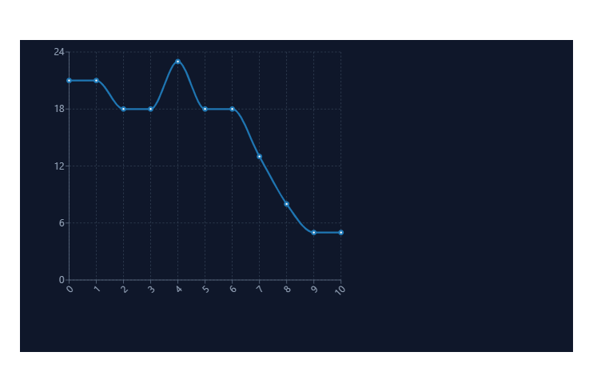

# Integrated Sprint Planning & Tracking Pack

## Chuẩn hóa ước lượng

Được ước lượng qua Planning Pocker phản ánh được độ phức tạp và cố định

### Phân loại và Xử lý các PBI

| Mã PBI | Trạng thái chốt | Lý do                                                                                                                                                                            | Phương án                                                                                    |
| ------- | ------------------ | --------------------------------------------------------------------------------------------------------------------------------------------------------------------------------- | ----------------------------------------------------------------------------------------------- |
| CF03    | 5 SP               | Phiếu cụm 5 chiếm đa số nhưng có rủi ro là 8 vì do "Thiếu quy tắc ngoài trường" nhưng vì Sprint Goal chỉ giao tại 2 căn tin nên luật này sẽ bị loại bỏ | Giới hạn AC: chỉ áp dụng cho 2 vị trí căn tin nội bộ                                  |
| CF04    | 8 SP               | Phiếu bỏ 8 nhiều hơn cũng như trạng thái đơn phụ thuộc lớn vào việc tối ưu hóa luồng giao                                                                      | Giữ mức độ phức tạp là 8 và tách phần "Cập nhật giao hàng ngoài " sang Sprint sau |
| CF06    | Cần xác định   | Quá thiếu nhiều dữ liệu cần phải xem được độ phức tạp là bao nhiều cũng như khoảng cách phiếu lớn 5 - 13                                                    | Tổ chức họp là rõ 1 ngày để làm việc với cổng thanh toán QR và SLA                |
| CF08    | Bỏ                | Vì thiếu AC không đủ để đưa vào Sprint                                                                                                                                  | Trả về Product Backlog để PO phân rã và cùng Team viết AC                              |

## Sprint Goal và phạm vi

### Sprint Goal: Vận hành thử nghiệm an toàn với luồng đặt món - Thanh toán QR - nhận món trực tiếp tại 2 căn tin nội bộ nhằm xác thực được nhu cầu người dùng

### Danh sách PBI được lựa:

1. CF01: Xem thực đơn/còn món (Sẵn sàng)
2. CF02: Tạo đơn/mã xác nhận (Phụ thuộc CF01)
3. CF03: Chọn điểm nhận (Đã giới hạn quy tác nội bộ)
4. CF06: Thanh toán QR (Giả định làm rõ thành công, chốt ở mức phức tạp cao)
5. CF07: Biên nhận điện tử (Phụ thuộc CF06)

+ Lý do không chọn CF04, CF05, CF08, CF09 vì tiết kiệm nguồn lực cũng như loại vỏ phần giao hàng chưa sẵn sàng, sẵn sàng tập trung vào luồng trực tiếp tại căng tin để đạt mục tiêu

## Task Breakdown và Capacity

### Tính toán Capacity thực tế

+ Lan: 54 giờ tổng
+ Minh: 48 giờ tổng
+ Ngọc: 45 giờ tổng
+ Phúc: 46 giờ tổng

=> Tổng Capacity toàn đội: 193 giờ:

### Kịch bản rủi ro

+ Minh nghỉ 2 ngày: Tổng gờ của minh có thể làm còn 48 - 12 = 36 giờ
+ Tác động: Sẽ làm nghẽ tại Backend. do luồng CF02 và CF06 phụ thuộc nặng vào Backend nên mục tiêu cũng sẽ bị lung lay
+ Giải pháp: Phúc sẽ tích hợp viết API Backend, Lan chỉ cần viết Mock Data để làm việc độc lập mà không cần đợi Backend

### Task Breakdown

CF01: Xem thực đơn

+ Task 1: Lan: Thiết kế UI hiển thị danh mục món ăn và trạng thái còn/hết (Đầu ra: Figma)
+ Task 2: Minh: Phát triển API Lấy danh sách thực đơn theo ngày từ DB (Đầu ra Swagger API)
+ Task 3: Ngọc: Kiểm thử dữ liệu hiển thị, test trường hợp món ăn hết hàng đột ngột (Đầu ra: Testlog)

CF02: Tạo đơn và Mã xác nhận

+ Task 1: Lan: Xây dựng màn hình giỏ hàng và nút "Đặt đơn" (Phụ thuộc: UI CF01)
+ Task 2: Minh: Xây dụng API tạo đơn hàng, trừ kho theo thời gian thực và sinh mã OTP/ mã xác nhận đơn (Đầu ra: API endpoint)
+ Task 3: Ngọc: Tạo test trường hợp trùng lặp đơn khi tạo, số lượng kho tồn bằng 0 khi đặt món (Đối ứng: Phối hợp với Minh)

CF03: Thanh toán QR:

+ Task 1: Phúc: Nghiên cứu tài liệu kết nối với cổng thanh toán
+ Task 2: Minh: Viết API nhận Callback trạng thái thanh toán tự động từ cổng QR (Phụ thộc: Task 1 Phúc)
+ Task 3: Lan: Nhúm Dyamic QR code lên màn hành thanh toán của APP (Đầu ra: UI hiển thị mã QR)
+ Task 4: Ngọc: Test các tình huống: Thành công, thất bại, timeout và mất mạng

## Burndown và Thích nghi (Burndown & Adaptation)

### Biểu đồ Sprint Burndown

### Điều tra 03 tín hiệu bất thường bằng giả thuyết & Kiểm tra dữ liệu

+ Ngày 04: Tăng từ 18 SP -> 23 SP: đồ thị dốc ngược lên
  + Giả thuyết: Đội ngũ nhận thêm việc và tự ý cập nhậtvào Sprint Backlog hiện tại mà không loại bỏ phần việc cũ tương đương
  + Dữ liệu cần kiểm: Log thay đổi Sprint Backlog trên Trello ngày 4 để xem ai đa thêm Task
+ Ngày 05: Biểu đồ vẫn giữ nguyên 18: Đồ thị nằm ngang
  + Giả thuyết: Đội ngũ làm Cổng QR đang bị chậm tiến độ không thể kiểm thử dẫn đến không hoàn thành được Task để burndown xuống
  + Dữ liệu cần kiểm: Log API cổng QR ngày thứ 5
+ Ngày 06: Tụt từ 18 xuống 13 nhưng không có biên bản
  + Giả thuyết: Cả đội tự thống nhất miệng hủy bỏ các task không khả thi ra khỏi Sprint để cứu Mục tiêu nhưng quên ghi chú lại
  + Dữ liệu cần kiểm thử: Lịch sử xóa task của ngày thứ 6

Đề xuất hành động thích nghi:

+ Triển khai họp Daily Scrum khẩn vấp 15 phút vào sáng ngày tiếp theo để làm rõ quyết định ngày 6. Ghi chú biên bản trực tiếp vào Jira Board công khai. Yêu cầu PO không được can thiệp đổi Scope giữa chừng trừ khi được Scrum Master chấp thuận dựa trên Capacity còn lại

## Ngoại lệ và Thay đổi (Exception & Change Management)

| Tình huống                                  | Tác động                                                                                                                | Quy trinhf xử lý và hành động khẩn cấp                                                                                                                      |
| --------------------------------------------- | -------------------------------------------------------------------------------------------------------------------------- | ------------------------------------------------------------------------------------------------------------------------------------------------------------------- |
| QR lỗi/chậm sau khi tạo đơ               | Đe dọa Sprint Goal nghiêm trọng, làm tắc nghẽn Burndown vào phút chót                                            | Thiết kế nút "Thanh toán tại quầy" hiển thị thay thế nếu kết nối QR bị timeout > 5 s. Đảm bảo đạt món vẫn chạy được và không vi phạm DoD |
| Thiếu SĐT/điểm ngoài trường            | Không ảnh hưởng đến Sprint Goal vì hiện tại mục thiệu chỉ khoanh trong 2 căn tin nội bộ                     | Kiên quyết từ chối xử lý trong Sprint này và đưa yêu cầu này vào Product Backlog để phân tích thêm cho các sprint sau                           |
| PO yêu cầu thêm mã KM (5 SP)              | Nguy cơ sẽ không kịp làm yêu cầu này và biểu đồ burndown sẽ cao hơn so với đường thực tế bất thường | Từ chối đưa trực tiếp vào Sprint hiện tại. Giải thích cho PO về giới hạn Capacity và đưa vào vị trí ưu tiên cao trong Sprint tiếp theo       |
| PBI mới đạt 80%, chưa qua kiểm thử lỗi | Vi phạm DoD. điểm Velociry sẽ không được tính cho PBI này                                                        | TuyKhoogn được đẩy lên thử nghiệm và chuyển việc đang dở dang về Product Backlog để tái đánh giá ở Sprint sau                                  |

### Phương thức công khai quyết định và Sprint Review

+ Công khai minh bạch: Mọi quyết định thay đổi Scope, thay đổi trạng thái PBI và kết quả phải được cập nhật trên Trello chung để PO và các bên liên quan theo dõi trực tiếp
+ Sprint Review: Demo trực tiếp luồng hoạt động thành công của việc đặt món và cơ chế Fallback khi QR lỗi. Công khai lý do từ chối tính năng khuyến mãi và lý do chuyển PBI 80% sang Sprint sau nhằm duy trì tính trung thực và kỷ luật của Agile
